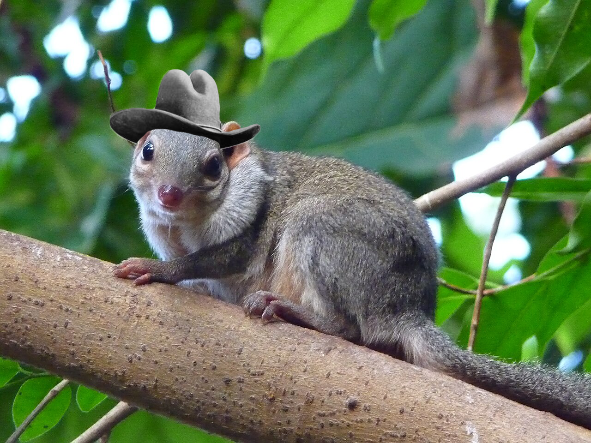
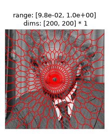

::::: {.grid}

:::: {.g-col-3}
::: {.sidebar-container}

{.profile-pic}

```{=html}
<div class="social-icons">
  <a href="https://github.com/emeyer121" target="_blank">
    <i class="bi bi-github"></i>
  </a>
  <a href="https://linkedin.com/in/emeyer121" target="_blank">
    <i class="bi bi-linkedin"></i>
  </a>
  <a href="assets/cv.pdf" target="_blank">
    <i class="bi bi-file-earmark-pdf"></i>
  </a>
</div>
```

::: {.contact-info}
emeyer121@gmail.com

**Computational Neuroscience PhD Student**  
University of Pennsylvania
:::

:::
::::

:::: {.g-col-9}

# Emily E Meyer

Computational Neuroscience PhD Candidate at the University of Pennsylvania. Excited about understanding how we process our visual environment using behavioral, computational, and neural data. Experienced in extracting signals from noisy, natural experimental paradigms and using models to learn more about brain and behavior.

## Projects

```{=html}
<div class="project-grid">

  <a href="posts/project1/index.html" class="project-card">
    
    <div class="project-overlay"><span>Project 1</span></div>
  </a>

  <a href="posts/project2/index.html" class="project-card">
    
    <div class="project-overlay"><span>Project 2</span></div>
  </a>

</div>
```

::::

:::::